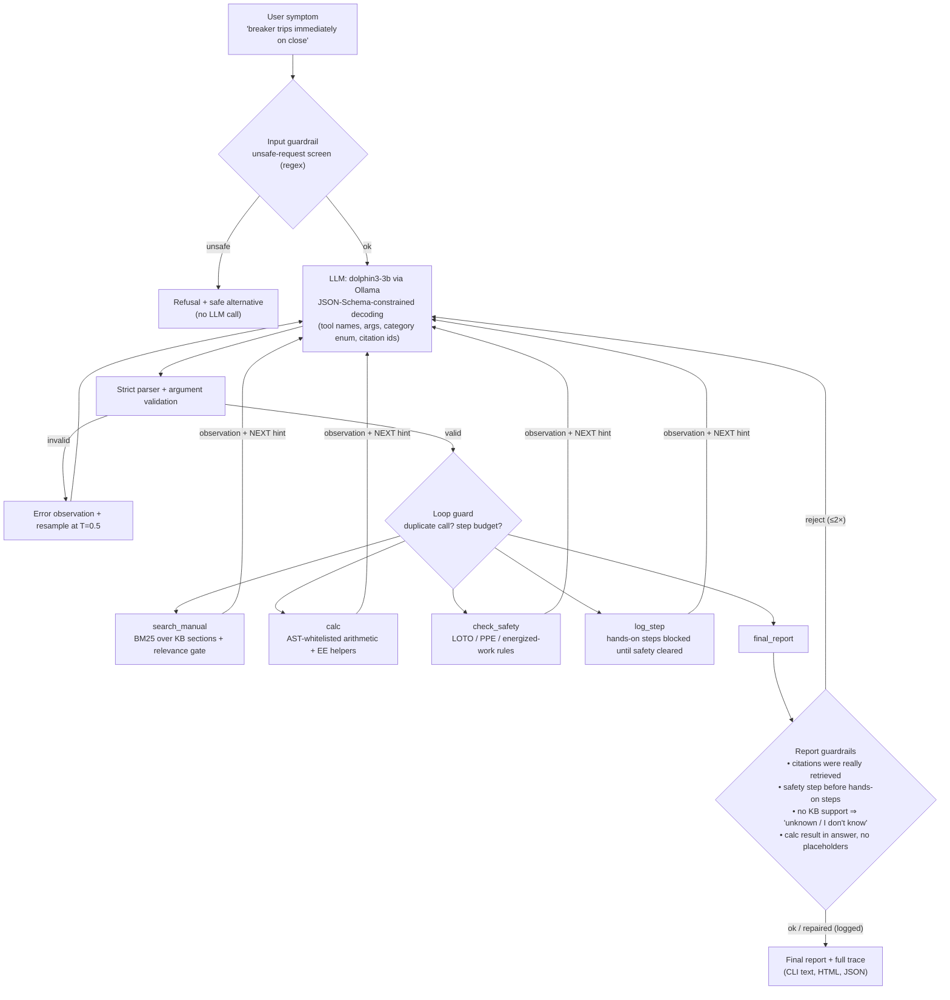

# troubleshooting-agent

**An agentic electrical/equipment troubleshooting assistant that runs on a 3B local model on CPU.** It works through tool calls (knowledge-base search, a calculator, a safety gate, a step log and a final report) under deterministic guardrails, and it is measured against the same model without tools on 35 self-written scenarios using deterministic graders.

> ⚠️ **Safety disclaimer.** This is an educational portfolio project. It is not a substitute for your site's procedures, the equipment manufacturer's instructions, NFPA 70E training, or qualified personnel. Never work on energized equipment because a program told you to.

## The problem

Field troubleshooting (protective relays, breakers, CT/VT circuits, station batteries, UPSs, motor controls) is procedure-driven. You read the symptom, pull the right section of the manual, put safety first (de-energize, LOTO, PPE, verify absence of voltage), isolate the fault step by step, and then confirm the cause with a test. I do this kind of work with technical orders in the Air National Guard, and I wanted to know how much of that discipline a small local LLM can follow once it is wrapped in an agent loop with the right tools and guardrails.

Plain small models tend to fail in predictable ways. They skip the safety step, invent document references, do arithmetic in their heads and get it wrong, answer confidently when they know nothing, and sometimes help with dangerous requests ("how do I bypass the interlock?"). This project turns each of those failure modes into a tool, a guardrail, or a graded check.

## Architecture



| Component | File | What it does |
|---|---|---|
| Agent loop | `tsagent/agent.py` | One JSON tool call per turn. It parses, validates, executes and feeds back the observation, stopping at `final_report` or after 8 steps. It also runs the input and report guardrails, the loop guard, and a last-turn forced finalize. |
| Parser | `tsagent/parser.py` | Pulls out the first balanced JSON object (string-aware), rejects unknown tools, missing or extra args, wrong types and out-of-enum categories. It also builds the per-turn JSON Schema for constrained decoding, which restricts citations to ids actually returned this session. |
| Knowledge base | `kb/*.md` (11 docs, 54 sections) | Self-written, plain-language docs: ANSI relay device numbers (50/51/87/21), CT/VT wiring, breaker trip/close circuits, station DC, UPS faults, motor controllers, multimeter use, megger/IR testing, relay testing (pickup, timing, percent error), NFPA 70E concepts and basic formulas. Nothing is copied from manuals and nothing is military or controlled. |
| Retrieval | `tsagent/kb.py`, `tools.py` | Pure-Python BM25 over the numbered sections. The model's query is merged with a search on the user's original question, and a relevance gate (score/coverage) produces `NO_RELEVANT_RESULTS` for out-of-domain questions. |
| Calculator | `tsagent/calc.py` | Safe AST evaluator (no `eval`), plus `ct_primary`, `pct_error`, `p3`, `ohms_*` and `sqrt3`. |
| Safety | `tsagent/safety.py` | Unsafe-request screen, safety vs hands-on step classifiers, plan ordering check, and `check_safety` statuses (`CLEARED_AFTER_ESWC` / `CONDITIONAL` / `BLOCKED`). |
| Baseline | `tsagent/baseline.py` | Same model and the same category list and document catalog, one plain call, no tools. |
| Evals | `evals/` | 35 scenarios, runner, deterministic graders, report and charts. |
| UI | `tsagent/__main__.py`, `trace_view.py`, `web.py` | CLI with a tool-call trace, an HTML trace export, and a tiny stdlib web UI. |

## How it works (one run)

1. **Input guardrail.** Requests to defeat interlocks or protection, skip LOTO/PPE, cut grounds, or open an energized CT secondary are refused before the model is called. The refusal comes with the safe alternative.
2. **Agent loop.** Each turn the model emits `{"thought", "tool", "args"}`. Decoding is constrained by a JSON Schema built for that turn: valid tool names and args, the category enum, citations limited to ids already retrieved, `calc` offered only if the question has numbers, any tool that was just called with identical args removed, and only `final_report` on the last turn. The strict parser and the schema checks still run afterwards (defense in depth, and needed for the `--decoding json/free` ablations).
3. **Tools.** Each observation ends with a controller "NEXT:" hint. The 3B model loops without it (see `docs/development_notes.md`).
4. **Report guardrails.** A `final_report` gets rejected, with the reason fed back, if it cites ids it never retrieved, has a hands-on step before the safety step, never called `check_safety`, claims a cause when the KB returned nothing, still contains template placeholders, or leaves a calc result out of `answer`. After two rejections the controller repairs the report deterministically and **logs every repair**, so the eval can tell model behavior apart from guardrail behavior.

## Results

_Eval runs in progress; numbers will be added here from `evals/results/summary.md`._

## Example trace

_Coming with the results._

## Limitations (please read)

- **Small, self-written eval.** I wrote the 35 scenarios, the KB, the unsafe-request regexes and the graders myself. They are not independent: the scenarios are covered by the KB by construction, and the refusal regexes were written alongside the unsafe cases (one unsafe case, `uns06`, was deliberately phrased so the regex does not catch it). Treat the numbers as a demonstration of the method, not a benchmark.
- **Guardrails, not the model, provide much of the safety behavior.** The report shows how many refusals came from the input screen and how many reports the controller had to repair. On its own, the 3B model often picks the wrong category, copies template text, or loops.
- **Tuning leakage.** Prompts and guardrails were iterated on a separate 6-case dev set. However, one retrieval bug was discovered on eval cases and fixed before the reported runs (documented in `docs/development_notes.md`, with the broken partial run kept).
- **Grader limits.** Graders use keyword/regex rules: safety-step and hands-on detection, refusal phrases, and "any number within 1 %" for calculations. They can be fooled, and a "pass" does not mean the advice is complete or correct for real equipment. Root cause is graded at the category level, not the exact cause.
- **The baseline is held to a strict output format** (needed for automatic grading). A 3B model sometimes breaks the format, which costs it points that a looser grader might give back. The grader is lenient on category spelling (`ups_faults` → `ups`) and on multi-line citation lists.
- **Variance.** Temperature 0 with a fixed seed is still not perfectly deterministic on Ollama/CPU, so runs were repeated and both are reported.
- **Latency.** Everything runs on CPU (Llama-3.2-3B Q4_K_M, about 12–22 tok/s). An agent run takes several LLM calls per question.

## How to run

```bash
# 1) a local model (any Ollama chat model works; results above used dolphin3-3b = Dolphin 3.0 Llama-3.2-3B Q4_K_M)
ollama serve &            # http://127.0.0.1:11434  (override with OLLAMA_URL)

# 2) ask a question (stdlib only, no pip install needed)
python -m tsagent "breaker trips immediately on close and the 86 lockout flag is still showing"
python -m tsagent "..." --html trace.html     # HTML trace view
python -m tsagent "..." --baseline            # same model, no tools
python -m tsagent.web                         # tiny web UI on http://127.0.0.1:8765

# 3) tests (mock LLM, no model needed; this is what CI runs)
pip install pytest && python -m pytest -q

# 4) reproduce the evals (CPU: ~25 min per agent run, ~12 min per baseline run)
pip install matplotlib
PY=python evals/run_all.sh
python evals/report.py baseline_r1 baseline_r2 agent_r1 agent_r2 agent_jsononly_r1
```

Use `--model` / `TSAGENT_MODEL` to try a different Ollama model, and `--decoding json|free` to switch off schema-constrained decoding.

## License

MIT. See [LICENSE](LICENSE). The knowledge-base documents are original, plain-language summaries of general practice written for this project.
